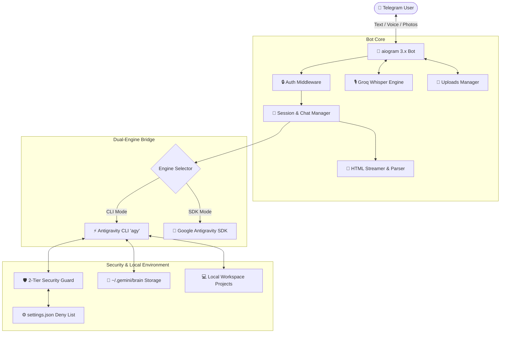

# 🤖 Antigravity Telegram Bot (`antigravity-tg-bro`)

[](https://www.python.org/downloads/)
[](https://github.com/aiogram/aiogram)
[](https://antigravity.google)
[](https://opensource.org/licenses/MIT)
[]()

> **A full-featured, secure mobile Telegram interface for your local [Google Antigravity](https://antigravity.google) development environment.**  
> Code, debug, execute shell commands, inspect local codebases, and interact with agentic tools from anywhere using **text, voice messages, and screenshots**.

---

## ✨ Key Highlights

* 🚀 **Dual-Engine Architecture**:
  * **CLI Mode (`agy`)**: Direct bridge to your local Google Antigravity CLI. Seamlessly leverages whichever Google account (free or AI Pro/Ultra) is authenticated locally on your machine via `agy auth`.
  * **SDK Mode (`google-antigravity`)**: Direct Google Cloud / AI Studio Gemini API fallback using `GEMINI_API_KEY`.
* ⚡ **In-Place Live Streaming**:
  * Real-time token streaming with 1.4s adaptive throttling to prevent Telegram API rate limits (FloodWait 429).
  * Native markdown-to-HTML parser with expandable thought blocks (`<blockquote expandable>`) and stylized tool execution traces.
* 🎙️ **Voice-to-Prompt (Groq Whisper)**:
  * Near-instant voice message transcription (~300–500ms) powered by `whisper-large-v3-turbo` via Groq Cloud API.
  * Custom IT vocabulary biasing (`data/whisper_prompt.txt`) ensures technical terms like `Next.js`, `Docker`, `Astro`, and `amoCRM` transcribe accurately.
  * *Optional*: Text & image capabilities work out-of-the-box even without a Groq key.
* 📸 **Multimodal & Vision Support**:
  * Send screenshots, architecture diagrams, and mockups directly from your phone.
  * Automatically isolated into `data/uploads/` and fed to Gemini 3.7 Flash Thinking / 3.1 Pro for instant visual inspection.
  * Auto-delivery of generated images, graphs, and artifacts back to your Telegram chat.
* 🛡️ **2-Tier Security Model**:
  * Native engine-level `deny`-list (`settings.json`) protects against destructive terminal commands (`rm`, `rmdir`, `sudo`, `git reset --hard`).
  * Interactive inline approval: Run blocked operations safely with one tap on `[ ⚡ Force Override ]` (`/force`).
  * Startup integrity scanner auto-restores safety rules on boot.
* 💬 **Multi-Chat & Session Memory**:
  * Switch between distinct dialog threads, create new branches, and rename active sessions via the interactive `/chats` menu.
  * Persistent turn continuity backed by `--conversation <ID>` and atomic disk serialization.
* 🍏 **24/7 Background System Daemon**:
  * Production-grade macOS `LaunchAgent` daemon (`antigravity-tg-daemon`) with automated reboot persistence and negligible footprint (~30MB RAM, 0% CPU idle).

---

## 🏗️ System Architecture



---

## 📱 Telegram Menu Commands

| Command | Action | Description |
| :--- | :--- | :--- |
| `💬 /chats` | **Chat Branches** | Switch between dialog branches, create new threads, or rename active chats |
| `📁 /project` | **Project Explorer** | Interactive filesystem browser for selecting active workspace folders |
| `🧠 /model` | **Model Switcher** | Select active model (Gemini 3.7 Flash, 3.1 Pro, Claude) and thinking effort |
| `⚙️ /settings` | **Settings Center** | Toggle security mode (Ask/Auto), switch engine (CLI/SDK), and clean upload cache |
| `📊 /status` | **Session Status** | View active directory, current model, session ID, and storage consumption |
| `📥 /get <path>` | **File Downloader** | Download any file directly from your local machine to your phone |
| `🛑 /stop` | **Emergency Halt** | Instantly terminates the running Antigravity process |
| `❓ /help` | **Quick Guide** | Displays help manual and shortcut tips |

---

## 🚀 Quick Start

### 1. Prerequisites
* **Python**: 3.10 or higher
* **Telegram Bot Token**: Created via [@BotFather](https://t.me/BotFather)
* **Google Antigravity CLI**: Installed and authenticated (`agy auth`) **OR** a `GEMINI_API_KEY` from [Google AI Studio](https://aistudio.google.com/apikey)
* **Groq API Key (Optional)**: Free key from [Groq Console](https://console.groq.com/keys) for voice transcription

### 2. Clone & Setup Virtual Environment
```bash
git clone https://github.com/serjdzen/antigravity-tg-bro.git
cd antigravity-tg-bro

python3 -m venv .venv
source .venv/bin/activate
pip install -r requirements.txt
```

### 3. Configure Environment Variables
Copy `.env.example` to `.env`:
```bash
cp .env.example .env
```
Edit `.env` with your settings:
```env
BOT_TOKEN=1234567890:ABCdefGHIjklMNOpqrsTUVwxyz
ALLOWED_USER_IDS=123456789
DEFAULT_PROJECTS_DIR=/path/to/your/projects
GROQ_API_KEY=gsk_...
```

### 4. Run Directly
```bash
./run.sh
```

---

## 🍏 24/7 macOS Daemon Service

Install as an automated background service managed by macOS `launchd`:

```bash
./scripts/service.sh install    # Generate LaunchAgent, link binary & start daemon
./scripts/service.sh status     # Check service health
./scripts/service.sh logs       # Stream real-time stdout/stderr logs
./scripts/service.sh restart    # Restart service
./scripts/service.sh stop       # Stop service
./scripts/service.sh uninstall  # Remove service from launchd
```

---

## 📚 Documentation

* 📖 **[DEPLOYMENT.md](DEPLOYMENT.md)** — Step-by-step deployment guide for humans (macOS, Linux systemd, Docker).
* 🤖 **[AGENTS.md](AGENTS.md)** — Machine-readable deployment & maintenance instructions for AI coding assistants.
* 🏛️ **[ARCHITECTURE.md](ARCHITECTURE.md)** — Detailed technical architecture, token decoding, and concurrency model.
* 🛡️ **[SECURITY.md](SECURITY.md)** — In-depth overview of the 2-tier security model and safe execution invariants.
* 🤝 **[CONTRIBUTING.md](CONTRIBUTING.md)** — Guidelines for contributing, submitting bug fixes, and feature requests.

---

## ⚖️ License

Distributed under the **MIT License**. See [`LICENSE`](LICENSE) for more information.
